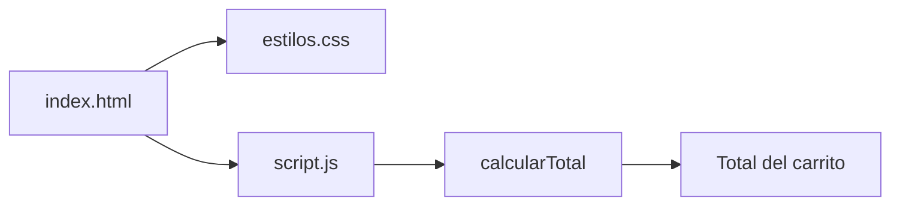

# Tienda TECSUP


Proyecto de practica para el Laboratorio 03 del curso Diseno de Interfaces de Programacion Avanzado.
Es una pagina de carrito de compras que muestra productos, precios, cantidades y el total a pagar.
Pensado para estudiantes que aprenden a colaborar con fork, Issues y Pull Requests.

## Tabla de contenidos

- [Instalacion](#instalacion)
- [Uso](#uso)
- [Archivos del proyecto](#archivos-del-proyecto)
- [Hoja de ruta](#hoja-de-ruta)
- [Arquitectura](#arquitectura)
- [Contribucion](#contribucion)

## Instalacion

```bash
git clone https://github.com/everreyes-stack/tienda-tecsup.git
cd tienda-tecsup
```

## Uso

1. Abrir el archivo `index.html` en el navegador.
2. Revisar la tabla con los productos del carrito.
3. Comprobar que la ultima linea diga `Total: S/ 68.00`.

Los productos del carrito estan en `script.js`:

```js
const productos = [
  { nombre: "Polo TECSUP", precio: 25.00, cantidad: 2 },
  { nombre: "Taza TECSUP", precio: 18.00, cantidad: 1 }
];
```

## Archivos del proyecto

| Archivo | Para que sirve | Lenguaje |
|:--------|:---------------|:--------:|
| index.html | La pagina con la tabla del carrito y el total | HTML |
| estilos.css | Los colores y la tipografia de la pagina | CSS |
| script.js | Calcula el total recorriendo los productos | JavaScript |
| README.md | Describe el proyecto y como usarlo | Markdown |

## Hoja de ruta

- [x] Corregir el calculo del total en la rama fix-total-carrito (Issue #379)
- [x] Corregir el enlace a estilos.css en la rama fix-enlace-estilos (Issue #381)
- [x] Abrir los Pull Requests hacia el repositorio del docente
- [ ] Que el docente acepte los Pull Requests

## Arquitectura



## Contribucion

Si encuentras un error, reportalo con un Issue y propon la correccion con un Pull Request.

Lee la [guia de contribucion](CONTRIBUTING.md) antes de enviar cambios.

## Autor

Hecho por **Ever Reyes** - [GitHub](https://github.com/everreyes-stack)